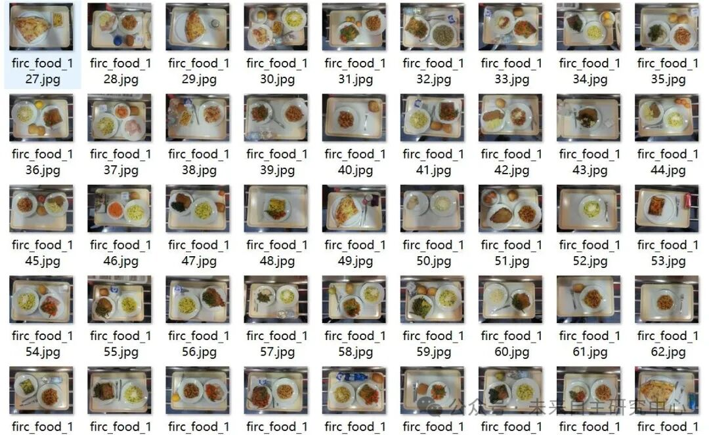
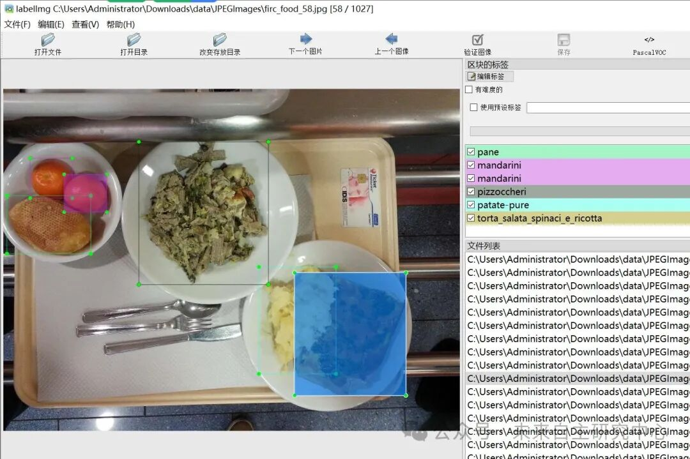

# Fast Food Plate Food Item Detection Dataset VOC+YOLO format with 1027 images and 73 categories

Dataset format: Pascal VOC format + YOLO format (txt file without split path, only containing jpg images and corresponding VOC format xml files and yolo format txt files)

Number of images (number of jpg files): 1027

Number of annotations (number of xml files): 1027

Number of annotations (number of txt files): 1027

Labeling category count: 73

1. Label names: ["arancia", "arrosto", "arrosto di velle", "banane", "bruscitt", "budino", "carote", "cavolfiore", "cibo bianco non identificato", "cotoletta", "crema zucca e fagioli", "fagiolini", "finocchi gratinati", "finocchi in umidio", "focaccia bianca", "guazzetto di calamari", "insalata 2-uova mai", "insalata mista", "lasagna alla bolognese", "mandarini", "medaglioni di carne", "mele", "merluzzo alle olive", "minestra", "minestra lombarda", "orecchiette -ragu-", "pane", "passato alla piemontese", "pasta bianca", "pasta cozze e vongole", "pasta e cecig", "pasta e fagioli", "pasta mare e monti", "pasta pancetta e zucchine", "pasta pesto besciamella e cornetti", "pasta ricotta e salsiccia", "pasta sugo", "pasta sugo pesca", "pasta sugo vegetariano", "pasta tono", "pasta tono e piselli", "pasta zafferano e piselli", "patate pure", "patate pure prosciutto", "patatine fritta", "pere", "pesce 2-filetto", "pesce -filetto", "piselli", "pizza", "pizzoccheri", "polpette di carne", "riso bianco", "riso sugo", "roastbeef", "rosbeef", "rucola", "salmone -da menu sembra spada in realta-", "scaloppine", "spinaci", "stinco di maiale", "strudel", "torta ananas", "torta cioccolato e pere", "torta crema", "torta crema 2", "torta salata 3", "torta salata -alla valdostana-", "torta salata rustica -zucchine-", "torta salata spinaci e ricotte", "yogurt", "zucchine impanate", "zucchine umido"]

Number of boxes labeled in each category:

Arancia Frames = 66

Arosto Frame Count = 62

arrosto_di_vitello frame count = 15

banane frame count = 22

Bruscitt frame count = 17

Budino Frame Count = 112

Carotene frame count = 161

cavolfiore frame count = 11

Cibo Bianco Non Identificato Frames = 7

Cotoletta frame count = 148

crema_zucca_e_fagioli frame count = 3

Fagiolini Frames = 131

Finocchi gratinati frame count = 37

Finocchi in Umido Frames = 12

focaccia_bianca Frames = 3

guazzetto_di_calamari Frames = 17

insalata_2_-uova mais- Frames = 1

insalata_mista frame count = 46

lasagna_alla_bolognese Frames = 66

Mandarini Frames = 198

medaglioni_di_carne Frames = 56

Mele box count = 73

merluzzo_alle_olive box count = 10

Minestra Frames = 3

minestra_lombarda box count = 12

orecchiette_-ragu- Frames = 39

Pane count = 479

Passato alla Piemontese Frames = 6

pasta_bianco box count = 11

pasta_cozze_e_vongole box count = 64

pasta_e_ceci box count = 5

pasta_e_fagioli box count = 16

pasta_mare_e_monti frame count = 45

pasta_pancetta_e_zucchine Frames = 42

pasta_pesto_besciamella_e_cornetti Frames = 70

pasta_ricotta_e_salsiccia Frames = 39

pasta_sugo box count = 16

pasta_sugo_pesce box = 65

pasta_sugo_vegetariano Frames = 80

pasta_tonno frame count = 31

pasta_tonno_e_piselli box count = 30

pasta_zafferano_e_piselli box count = 52

patate-pure frame count = 151

patate-pure_prosciutto Frames = 49

patatine_fritte frame count = 64

Pere Frames = 35

pesce_2_-filetto- Frames = 17

pesce_-filetto- Frames = 9

Piselli frame count = 26

Pizza frame count = 89

Pizzoccheri Frames = 38

polpette_di_carne frame count = 45

riso_bianco frame count = 57

riso_sugo frame count = 31

Roast beef frame count = 7

Rosbeef frame count = 7

rucola box count = 1

salmone_-da_menu_sembra_spada_in_realta- Frame count = 21

Scapoppine frame count = 93

Spinaci frame count = 110

Stinco_di_maiale Frame Count = 13

Strudel Frame Count = 1

torta_ananas box count = 2

torta_cioccolato_e_pere frame count = 3

torta_crema frame count = 6

torta_crema_2 frame count = 7

torta_salata_3 frame count = 25

torta_salata_-alla_valdostana- Frames = 22

torta_salata_rustica_-zucchine- Frames = 48

torta_salata_spinaci_e_ricotta Frames = 54

Yogurt frame count = 130

zucchine_impanate frame count = 9

zucchine_umido frame count = 67

Total frame count: 3616

Using labelImg:

Annotation rules: Draw a rectangle around the category.

Important Notice: No

Special : This dataset does not guarantee the accuracy or precision of the trained models or weight files. The dataset is provided with accurate and reasonable annotations only.

Image Preview:

Annotation example:

## Payment

Here is a pay link on Stripe ( https://buy.stripe.com/3cs8yP7sY87d0vu9AB ). Please contact me lonlonago@foxmail.com after funding $89, and I will send you a complete data files , thank you!

